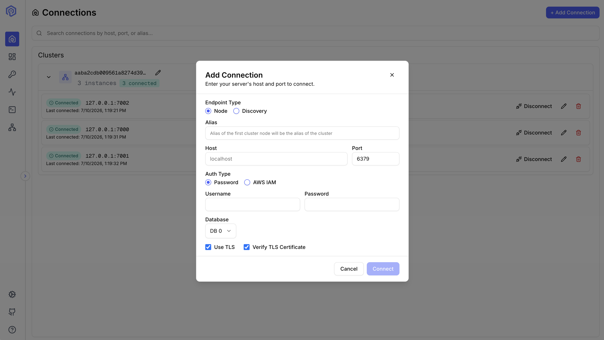

Valkey Admin supports connecting to both standalone Valkey instances and clusters. The connection modal provides two endpoint types and optional database selection.

## Endpoint Types

### Node Endpoint

A node endpoint connects directly to a specific Valkey instance by its host and port. Use this when you know the exact address of the node you want to reach.

After connecting, Valkey Admin checks whether the node belongs to a cluster (`cluster_enabled:1` in `INFO`). If it does, the full cluster topology is discovered automatically from that single node — you still get the complete cluster experience.

**When to use:**
- Connecting to a standalone Valkey instance
- Connecting to a specific node in a cluster when you know its address
- Connecting to managed services where you have a direct node hostname

### Discovery Endpoint

A discovery endpoint connects via a cluster configuration endpoint (e.g., ElastiCache `clustercfg.*` endpoints). These DNS names can resolve to any node in the cluster.

Valkey Admin discovers the full cluster topology from whichever node the DNS resolves to, then starts metrics collection for all primary nodes.

**When to use:**
- Connecting to an ElastiCache cluster via its configuration endpoint
- Any DNS endpoint that load-balances across cluster nodes

:::note
Both endpoint types result in the same cluster experience when connecting to a cluster node. The difference is how the initial connection is established, not what you see after connecting.
:::

## Numbered Databases

Valkey supports multiple logical databases per instance (default: 16, numbered `0` through `15`, configurable via `databases`). The connection modal exposes a **Database** number field accepting any non-negative integer — there is no static upper bound in the UI, because the valid range depends on the target server.

At connect time the server validates the requested index against the live server's configured count (`CONFIG GET databases`, or `cluster-databases` for Valkey 9+ clusters) and rejects out-of-range values with a message naming the configured count and valid range. Once connected, the learned count is shown in the Edit Connection form as the valid range for that server.

Each `(host, port, db)` combination creates an independent client connection. Switching databases opens a new connection rather than running `SELECT` on an existing one — operations in one database never affect another.

### Cluster Mode

- **Valkey 9.0+**: Multiple databases are supported in cluster mode. Set `--cluster-databases <n>` on every cluster node to enable.
- **Below 9.0**: Only `db 0` is available in cluster mode. The server rejects non-zero values with a clear error naming the cluster version.

### Standalone Mode

All Valkey versions support numbered databases in standalone mode, up to the server's configured `databases` limit.

## Authentication

Valkey Admin supports three authentication methods:

### Password Authentication

Provide a username and password. If no username is specified, the default ACL user is used. If you give a username without a password, Valkey Admin sends no credentials and the connection runs as the `default` user.

Every command runs as the Valkey user you connected with, and the metrics you see were collected with your credentials. Valkey Admin checks your credentials with the node you name on every connect, also when another user already connected to the same node, and it reaches only the state of your Valkey user on that node. Host names are case-insensitive, and a trailing dot is ignored. The port must be a plain number from 1 to 65535 with no leading zeros. Connections saved by an earlier version with a differently spelled host are renamed when the app loads, so they keep reconnecting. If two saved connections now spell the same host (for example `My-Cache-001.abc123.0001.usw2.cache.amazonaws.com` and `my-cache-001.abc123.0001.usw2.cache.amazonaws.com`), the one already saved under the new spelling is kept as is and the other keeps its old name; edit or delete it. See [Users and Valkey identities](/configuration/server/#users-and-valkey-identities).

In the web app, the browser does not keep the password across a page reload. After a reload, or in a new tab, enter the password again to reconnect. The desktop app with an OS keystore reconnects without asking. IAM, GCP IAM and passwordless connections reconnect automatically.

### AWS IAM Authentication

For ElastiCache clusters with IAM authentication enabled, provide:
- **Username**: The IAM-enabled user ID
- **AWS Region**: The region where the cluster is deployed
- **Replication Group ID**: The ElastiCache cluster name

Valkey Admin generates short-lived IAM auth tokens automatically. The server signs each token with its own AWS credentials and sends it as the AUTH password to the host you enter, so TLS **with certificate verification** is required; a connection with TLS off is refused. ElastiCache requires in-transit encryption for IAM in any case.

### GCP IAM Authentication

For Memorystore for Valkey instances with IAM authentication enabled, select **GCP IAM**. No username or password is required — Valkey Admin mints a short-lived OAuth2 access token from the ambient Application Default Credentials (Workload Identity in GKE, the metadata server on GCE, or `GOOGLE_APPLICATION_CREDENTIALS` locally) and rotates it before expiry, including across every cluster node. Connections authenticate as the `default` user, which is the only username Memorystore for Valkey supports. TLS **with certificate verification** is required, and the operator must set `VALKEY_CA_CERT_PATH` to the instance's server CA. The token is a bearer credential for the server's whole Google Cloud identity, and that CA file is what limits it to your Memorystore instance: Glide trusts only that CA, so the token cannot be sent to a host that presents some other certificate. A GCP IAM connection is refused when the variable is not set. The UI has no CA field; a `caCertPath` in a connection request is ignored.

## TLS

Enable TLS for encrypted connections. Optionally verify the server certificate — disable verification only for self-signed certificates in development environments.

## Next Steps

- Browse keys after connecting with the [Key Browser](/features/key-browser/)
- Monitor performance in [Activity](/features/activity/)
- Configure pre-configured connections via [environment variables](/deployment/docker/#with-pre-configured-connection)
