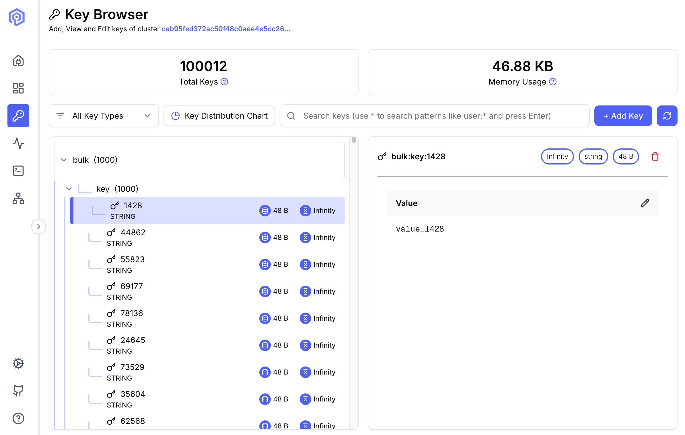

The Key Browser provides a powerful interface for exploring and managing keys stored in your Valkey cluster.

## Overview

Navigate through your keyspace with an intuitive interface that supports filtering, searching, and adding.



## Key Features

### Browsing Keys

- **Tree View**: Navigate keys organized by namespace separators (`:`)
- **Pagination**: Handle large keyspaces efficiently

### Search and Filter

#### Pattern Matching

Use Redis/Valkey pattern matching syntax:
```
user:*          # All keys starting with "user:"
*:session       # All keys ending with ":session"
user:*:cache    # Keys matching the pattern
```

#### Type Filtering

Filter keys by data type:
- **String**: Simple key-value pairs
- **Hash**: Field-value maps
- **List**: Ordered collections
- **Set**: Unordered unique collections
- **Sorted Set**: Scored, ordered sets
- **Stream**: Append-only logs
- **JSON**: ReJSON-style document values (requires the JSON module)

## Key Operations

### Viewing Keys

#### String Values
View string values with syntax highlighting for JSON, XML, and other formats.

#### Hash Fields
Display fields and values in a paginated table format.

#### List Elements
Browse list elements with pagination.

#### Set Members
View members of a set with pagination.

#### Sorted Set Entries
Display entries with their scores, paginated for large collections.

All collection types (hash, list, set, sorted set) use pagination to handle large data structures efficiently. Only a page of elements is loaded at a time, preventing the browser from blocking on keys with millions of members.

### Editing Keys

- **Update Value**: Modify existing key values
- **Add Fields**: Insert new hash fields or list elements

## Key Details Panel

Click any key to view detailed information:

- **Name**: Key Name
- **Type**: Data structure type
- **Size**: Actual size in bytes
- **TTL**: Time to live (if set)

### Value Viewer

- **Raw View**: Display raw value for String types
- **Table View**: Hash, List, Set, Stream, and Zset types
- **Json View**: JSON data

### Decompressing Values

String values stored compressed can be decoded on request. Nothing is decompressed automatically: the viewer always shows the stored value, and the decoded value appears below it, labeled **Decompressed (format): read-only view**. It can't be edited, and nothing is written back to Valkey.

- **Decompress** loads the value's exact bytes and decodes them in your browser, not on the server. For keys over the display size limit, the button is **Load and decompress**.
- **Detect format** recognizes gzip, zlib, zstd, LZ4 frames, Snappy framed streams, and values written by a [Valkey GLIDE](https://github.com/valkey-io/valkey-glide) client with compression enabled (zstd or LZ4). A badge such as **looks like zstd** shows when a value's first bytes match one of these; it is only a guess until you decompress.
- Choose a format from the list to override detection, or for formats without a signature: **LZ4 raw block** and **Snappy raw**.
- Decoded JSON is pretty-printed, other UTF-8 text is shown as text, and anything else (including text with control characters such as NUL bytes) as a hex dump. Data that doesn't match the format shows an error such as "Not valid zstd data".
- Decoding stops after 10 MiB of output and marks the result as truncated; **Continue** decodes the next 10 MiB and shows that newly decoded part. Truncated output is shown as plain text. At most 1 MiB of output is rendered at a time; **Show from byte…** pages through decoded output beyond that before decoding further. Values larger than 16 MiB can't be decompressed. All three limits are configurable: see [`KEY_RAW_VALUE_MAX_BYTES`, `DECOMPRESS_MAX_OUTPUT_BYTES` and `DECOMPRESS_PREVIEW_MAX_BYTES`](/configuration/server/#key_raw_value_max_bytes).
- **Cancel** stops a decode in progress.

Checksums are not verified: gzip CRC-32, zlib Adler-32, LZ4 xxHash32 and Snappy CRC-32C. Corrupted data that still decodes is shown without an error. GLIDE compression is experimental in GLIDE, so only its current header format (version 0) is accepted.

## Switching Databases

Each `(host, port, db)` triple maps to its own client connection on the server, so the Key Browser is always scoped to the database you connected to. Switching to a different `db` opens a new client side-by-side with the existing one rather than issuing `SELECT` against an existing client, so operations like `KEYS`, `SET`, and `DEL` against one database never affect keys in another database on the same node. For cluster connections this only applies when the Valkey server is at version `9.0.0` or higher; earlier cluster servers always operate on `db` `0` and a non-zero `db` is rejected at connect time.

## Next Steps

- Execute commands with the [Send Command interface](/features/send-command/)
- Monitor key access with [Activity](/features/activity/)
- Visualize data distribution in [Cluster Topology](/features/cluster-topology/)
